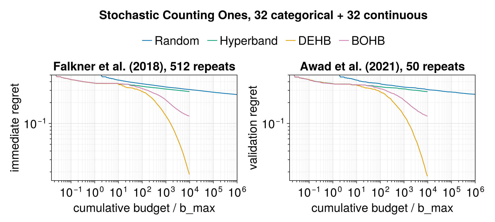

# Practical recommendations and benchmarks

`BigHOPs.jl` contains benchmarks such that the different samplers could be compared, which serves to both confirm the correctness of the implementation and as a source of higher level practical recommendations. The code used to run the benchmarks can be found [here](https://github.com/dom-linkevicius/BigHOPs.jl/tree/master/benchmarks).

## Practical recommendations

The practical recommendations come from the benchmarks below, so treat them as a starting point rather than a rule, as the benchmarks may not capture the specifics of your problem.

```@raw html
<style>
.recommendations li strong:first-child { display: block; }
</style>
```

```@raw html
<div class="recommendations">
```

- **Try to frame the optimization objective in a way that would allow the usage of a successive-halving-based sampler**

    The adaptive successive-halving based samplers (`BOHB` and `DEHB`) are currently the most performant `BigHOPs.jl` has in terms of time, objective values reached and budget used. For the heaviest jobs with under 20 hyperparameters `BOHB` with a `Stateful` objective is likely to offer the best compromise. For more hyperparameters `DEHB` is likely to perform better, but at a higher computational cost.
- **Run a few individual objective evaluations to scout how much resource the objective needs before different candidates can be told apart**

    Correct specification of resource usage will make the runs more efficient, as if the badly performing objectives can be told apart after $100$ iterations, there is no need to train them to convergence.
- **It is usually a good idea to record metrics of interest that are cheap to store and save them in the `post_artefact`**
- **Checkpoint and inspect the runs** 

    `BigHOPs.jl` has convenience functionality which should make this relatively fast and easy, potentially saving you time in case your objective has converged, is noisy and not worth waiting for or just has a high failure rate due to some other reasons. 

```@raw html
</div>
```

The problems on which the above recommendations are based are the following:

## Problems

```@raw html
<details class="details custom-block"><summary>Stochastic Counting Ones</summary>
```




```@raw html
<details class="details custom-block"><summary>Problem definition</summary>
```

The problem comes from [Falkner2018](@citet), and is also used in [Awad2021](@citet). The objective is

```math
f(x) = -\left(\sum_{x \in X_{cat}} x + \sum_{x \in X_{cont}} \mathbb{E}_b[B_{p=x}]\right)
```

over binary hyperparameters $X_{cat}$ and continuous hyperparameters $X_{cont}$ in $[0, 1]$, in two sizes: 8 of each, so $d = 16$, and 32 of each, so $d = 64$. Each continuous hyperparameter's Bernoulli mean is estimated from $b$ samples, so $b$ is the resource, and a low-resource evaluation is a noisy one. The optimum sets every hyperparameter to $1$.

The metric is the normalized regret $\frac{f(x) + d}{d}$, so $0$ is the optimum and $1$ the worst case, plotted against the budget spent, in units of full evaluations ($b = 729$). The two papers compute it differently, so each figure shows both:

- **Left, the immediate regret of [Falkner2018](@citet):** "the immediate regret $|f(x_{inc}) - f(x^*)|$ where $x^* \in \arg\min f(x)$ and $x_{inc}$ is the incumbent at a specific time step", with $f$ the noise-free objective above. The incumbent is the best measured trial at the highest resource level reached so far. It shows how good the configuration one would pick really is.
- **Right, the validation regret of [Awad2021](@citet):** "the difference of validation score from the global best", where the score is the noisy measurement of the incumbent, for every sampler. A trial becomes the incumbent when its resource level is at least the incumbent's and it measures a lower score.

```@raw html
</details>
<details class="details custom-block"><summary>Computational setup</summary>
```

- `RandomSampler` evaluates every trial at the full $b = 729$.
- `Hyperband`, `DEHB` and `BOHB` use $r_{min} = 9$, $R = 729$ and $\eta = 3$, as in [Falkner2018](@citet), and otherwise their default settings. [Awad2021](@citet) use 8 times as many samples at every resource level for $d = 16$, and twice as many for $d = 64$.
- Every sampler gets a budget of $10^4$ full evaluations, except `RandomSampler` at $d = 64$, which gets $10^6$; the successive-halving samplers repeat their schedule until they reach it.
- Each sampler is run 50 times with different seeds, each run under `Serial`, with the runs spread over parallel workers. The curves show the mean and its standard error.

```@raw html
</details>
<details class="details custom-block"><summary>Comparison to source publication</summary>
```

**16 dimensions.** The left column compares to Figure 3 of [Falkner2018](@citet), and the right column to the 8+8 panel of Figure 18 of [Awad2021](@citet).

- `RandomSampler` and `Hyperband` match the random search and Hyperband curves of [Falkner2018](@citet).
- `BOHB` matches the `BOHB` curve of [Falkner2018](@citet) up to about $10^3$ full evaluations, e.g. about $2 \cdot 10^{-2}$ at $200$ for both. Theirs then drops below $10^{-3}$, the bottom of their plot, at about $1.5 \cdot 10^3$, while ours reaches $1.1 \cdot 10^{-3}$ at $2 \cdot 10^3$. We have not found the reason for this difference. Scheduling brackets width-first, smaller brackets, the incumbent rule, the budget accounting and the plotted metric were all checked and ruled out.
- `DEHB` stays above `BOHB`, while in the panel of [Awad2021](@citet) it drops below `BOHB` at about $3000$ full evaluations. Their `DEHB` curve uses the lowest score measured at any resource level instead of the incumbent's, and with few samples a good but not optimal configuration can measure a regret of exactly $0$.
- `BOHB` levels off at about $1.5 \cdot 10^{-4}$ in the panel of [Awad2021](@citet), while ours keeps falling. Their evaluations use more samples and so are less noisy, which makes the right column only roughly comparable to theirs.

**64 dimensions.** Both columns follow the axes of Figure 6 of [Awad2021](@citet), which plots the validation regret. The two regrets give almost the same curves here.

- `RandomSampler` matches their random search.
- `DEHB` is close to theirs: it reaches $0.02$ at about $9 \cdot 10^3$ full evaluations, where theirs needs about $7 \cdot 10^3$.
- `BOHB` does better than theirs, which levels off at about $0.22$, while ours reaches $0.13$ at $10^4$ full evaluations. One known difference is that [Awad2021](@citet) ran `BOHB` with a minimum bandwidth of $0.3$ (their Appendix D.1), where we use HpBandSter's default of $10^{-3}$.
- `Hyperband` is not in their Figure 6. It stays close to `RandomSampler` here, as it does in the 32+32 panel of their Figure 18.

```@raw html
</details>
</details>
<details class="details custom-block"><summary>Neural network hyperparameter search</summary>
```


```@raw html
<details class="details custom-block"><summary>Problem definition</summary>
```

A small multilayer perceptron predicts survival on the Titanic dataset (from `MLDatasets.jl`), trained on $80\%$ of the passengers with Adam and a batch size of $32$. The objective is the cross-entropy loss on the remaining $20\%$, minimized over five hyperparameters:

- learning rate, log-uniform in $[10^{-5}, 10^{-1}]$;
- number of dense layers, $1$ to $3$;
- hidden width, $8$, $16$, $32$ or $64$;
- activation, `tanh` or `relu`;
- L2 regularization strength, log-uniform in $[10^{-6}, 10^{-1}]$.

The benchmark is our own, so there is no source publication. Since the true optimum is not known, the metric is the regret against the best validation loss seen across every run of the benchmark: a run's best loss so far minus that best loss, plotted against wall-clock time.

```@raw html
</details>
<details class="details custom-block"><summary>Computational setup</summary>
```

- `Hyperband`, `ASHA`, `DEHB` and `BOHB` run one pass of their schedule, with $R = 1215$, $\eta = 3$ and $r_{min} = 5$, giving 6 brackets. One resource unit is $6$ training epochs, so a trial trains for $30$ to $7290$ epochs. `Hyperband`, `ASHA` and `BOHB` continue promoted trials through `Stateful`, while `DEHB` trains every trial from scratch.
- That schedule tries 415 configurations and spends about $2.05 \cdot 10^5$ epochs, so `RandomSampler`, `LHSampler` and `SobolSampler` get 415 trials with the same epochs in total, split evenly between them. No sampler gets more compute than another.
- Each sampler runs under `Serial` and under `Threaded` on 64 threads, 20 times each. The figure shows the median.

```@raw html
</details>
</details>
```
