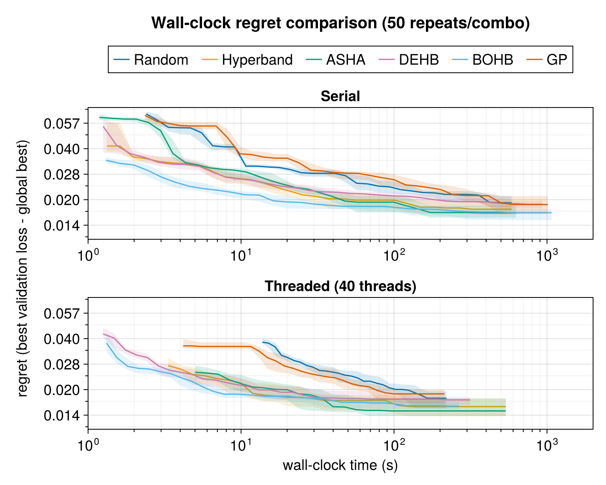

# Benchmarks

To check that the samplers and executors deliver what they promise, the repository runs two benchmarks: a toy function from the literature, where the optimum is known and published results can be compared against, and a real neural network hyperparameter search, where wall-clock time and executor behaviour matter. The code is in [`benchmarks/`](https://github.com/dom-linkevicius/BigHOPs.jl/tree/master/benchmarks).

## Stochastic Counting Ones

This benchmark comes from Falkner et al. (2018), the paper that introduced BOHB, and is also used in §5.1 of Awad et al. (2021), the paper that introduced DEHB. The objective is

```math
f(x) = -\left(\sum_{x \in X_{cat}} x + \sum_{x \in X_{cont}} \mathbb{E}_b[B_{p=x}]\right)
```

over binary and continuous hyperparameters, where the resource `b` is the number of Bernoulli samples used to estimate each continuous variable's mean, so a low-resource evaluation is a noisy one. The schedule is `r_min=9`, `R=729`, `η=3`, as in the papers. Regret is normalized as `(f(x) + d) / d`, with `d` the total number of hyperparameters, so 0 is the optimum and 1 the worst case. The plotted regret is the true, noise-free regret of the incumbent, the best measured trial at the highest resource level reached so far. Each sampler is run 50 times, and the curves show the mean with its standard error.

With 8 binary and 8 continuous hyperparameters (`d = 16`), every sampler gets a cumulative budget of 10⁴ full evaluations:


With 32 binary and 32 continuous hyperparameters (`d = 64`), `RandomSampler` gets 10⁶ full evaluations, and `Hyperband`, `DEHB` and `BOHB` get 10⁴:


Mean normalized regret at a given cumulative budget, in units of full evaluations:

| `d = 16` | 10 | 10² | 10³ | 10⁴ |
|:--|--:|--:|--:|--:|
| `RandomSampler` | 0.35 | 0.25 | 0.19 | 0.14 |
| `Hyperband` | 0.24 | 0.19 | 0.15 | 0.12 |
| `DEHB` | 0.22 | 0.13 | 0.015 | 9.7e-4 |
| `BOHB` | 0.14 | 0.038 | 2.0e-3 | 5.5e-4 |

| `d = 64` | 10² | 10³ | 10⁴ | 10⁶ |
|:--|--:|--:|--:|--:|
| `RandomSampler` | 0.37 | 0.33 | 0.31 | 0.26 |
| `Hyperband` | 0.34 | 0.32 | 0.29 | |
| `DEHB` | 0.29 | 0.13 | 0.018 | |
| `BOHB` | 0.32 | 0.22 | 0.13 | |

What the results show:

- **Cheap evaluations help early, but not for long.** `Hyperband` gets ahead of `RandomSampler` early on (0.26 against 0.51 after one full evaluation's worth of budget at `d = 16`), because low-resource trials let it look at many more configurations. But it still draws every configuration at random, so afterwards it improves at the same slow rate as random search and ends only slightly lower.
- **Learning from earlier trials is what makes the difference.** `BOHB` and `DEHB` both use the results of previous trials to choose new ones. At `d = 16`, both end more than two orders of magnitude below `Hyperband`.
- **`BOHB` is best with 16 hyperparameters.** It has the lowest regret at every budget, reaching 10⁻² in about 300 full evaluations, where `DEHB` needs about 1200. Its curve closely follows Figure 3 of Falkner et al. (2018) up to about 700 full evaluations, and is somewhat slower to reach 10⁻³ after that.
- **`DEHB` is best with 64 hyperparameters.** It reaches 0.018 at 10⁴ full evaluations, where `BOHB` is at 0.13. `BOHB`'s model needs more than `d` completed trials in both its good and its bad set before it can be fitted at all (at least 130 trials at a resource level when `d = 64`), and Scott's rule bandwidths shrink as `n^(-1/(d+4))`, so in 64 dimensions its densities stay broad. Falkner et al. (2018) also report `BOHB` losing ground at 64 dimensions on this benchmark.
- **Random search barely moves in high dimensions.** With a hundred times the budget, `RandomSampler` ends at 0.26, far above `DEHB`'s 0.018.

## Neural network hyperparameter search

The second benchmark trains a small MLP on the Titanic dataset (via `MLDatasets.jl`), minimizing validation loss over five hyperparameters: learning rate, number of dense layers, hidden width, activation, and L2 regularization strength.

The comparison is set up as "same budget, who gets there first":

- `Hyperband`, `ASHA` and `DEHB` run their own one-pass bracket schedule (`R=1215`, `η=3`, `r_min=5`, giving 6 brackets), where one resource unit is 6 training epochs, so a bottom-rung trial trains for 30 epochs and a top-rung one for 7290.
- That schedule tries 415 distinct configurations and spends about 205k epochs in total, so `RandomSampler`, `LHSampler` and `SobolSampler` are given the same: 415 trials, with their per-trial epoch count set so the totals match. No sampler gets more compute than another; only the way it is spent differs.
- Each sampler runs under `Serial` and under `Threaded` (64 threads); the problem is not large enough to warrant `DistributedQueue`.
- Every sampler and executor combination is repeated 20 times, and the figure shows the median.

Regret is a run's best validation loss so far minus the best loss seen across every run in the benchmark (0.425), since the true optimum is not known.



Median wall-clock time to reach a given regret, and median total time per run:

| | regret ≤ 0.03 | regret ≤ 0.02 | total, `Serial` | total, `Threaded` | speed-up |
|:--|--:|--:|--:|--:|--:|
| `RandomSampler` | 11.6 s | 124 s | 291 s | 38.5 s | 7.6× |
| `LHSampler` | 32.1 s | not reached | 279 s | 37.2 s | 7.5× |
| `SobolSampler` | 28.8 s | not reached | 281 s | 37.6 s | 7.5× |
| `Hyperband` | 3.0 s | 11.8 s | 278 s | 52.4 s | 5.3× |
| `ASHA` | 2.5 s | 22.8 s | 272 s | 51.6 s | 5.3× |
| `DEHB` | 3.0 s | 55.0 s | 415 s | 68.9 s | 6.0× |

The first two columns are for `Serial`; "not reached" means the median run never got there.

What the results show:

- **Successive halving gets there first.** Under `Serial`, the successive-halving samplers reach a regret of 0.03 in about 3 s, against 12–32 s for the full-budget samplers, and `Hyperband` reaches 0.02 ten times sooner than `RandomSampler`. Under `Threaded` the gap is wider still: their first results arrive within a fraction of a second, while the full-budget samplers' first trials take about 4 s to finish.
- **The final results are close.** Every sampler ends within 0.017–0.022 of the best loss. With five hyperparameters and a noisy objective, random draws find good configurations eventually, so the advantage of successive halving here is speed rather than a lower final loss.
- **Space-filling designs did not help.** `LHSampler` and `SobolSampler` ended level with `RandomSampler`, and were no faster to reach low regret.
- **`DEHB` costs more per run.** It takes about 50% longer than `Hyperband` and `ASHA` under `Serial`, because it trains every trial from scratch, while they continue promoted trials from their saved state through `Stateful`.
- **`Threaded` speeds everything up.** On 64 threads, the full-budget samplers run 7.5× faster than under `Serial`, since all their trials are independent. The successive-halving samplers gain 5–6×, most likely because promotions have to wait for earlier results, and the few long top-rung trials at the end of the schedule leave most threads idle.

## Practical recommendations

These follow from the two benchmarks above, a toy problem and one small neural network, so treat them as a starting point rather than a rule.

- **If the objective has a resource knob, use a successive-halving sampler.** Epochs, training samples and simulation steps all work, as long as a larger `p.r` gives a more accurate evaluation. In both benchmarks this reached good configurations far sooner than spending the full budget on every trial. Wrap the objective in `Stateful`, so that promoted trials continue instead of starting over.
- **Pick the successive-halving sampler by the size of the search space.**
  - With a handful of hyperparameters, `Hyperband` or `ASHA` with the default random inner sampler is a robust, cheap choice.
  - With around 16, `BOHB` did best.
  - With around 64, `DEHB` did best. Keep in mind that it trains every trial from scratch, so it costs more wall-clock time per run with a `Stateful` objective.
- **Without a resource knob, start with `SobolSampler` or `RandomSampler`.** `SobolSampler` needs no fixed number of trials; `LHSampler` needs `n` up front. In our benchmark neither did better than `RandomSampler`, but they do cover the space more evenly when only a few trials are affordable.
- **Pick the executor by where the trials run.**
  - `Serial` is for development and debugging.
  - `Threaded` is for one machine; it gave a 5–7.5× speed-up on 64 threads.
  - `DistributedQueue` is for clusters, or for trials that need a process of their own or a time limit (`max_single_runtime`).
- **Checkpoint long runs** with `save_every` and `save_path`, so that a crash does not lose the trials already evaluated.
