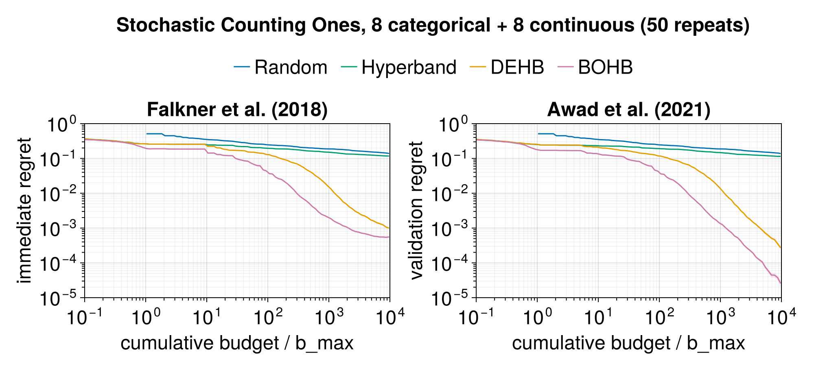

# Benchmarks

## Practical recommendations

These come from the benchmarks below, so treat them as a starting point rather than a rule.

- **With a resource knob, use a successive-halving sampler.** If a larger `p.r`, such as more epochs, samples or simulation steps, gives a more accurate evaluation, successive halving reaches good configurations much sooner than spending the full budget on every trial. Wrap the objective in `Stateful`, so that promoted trials continue instead of starting over.
- **Pick it by the size of the search space.** With a handful of hyperparameters, `Hyperband` or `ASHA` with random draws is a cheap and robust choice. With more, a model-based sampler pays off: `BOHB` did best on the smaller counting ones problem, and `DEHB` on the larger one, where `BOHB`'s density model needs many completed trials before it can be fitted. `DEHB` trains every trial from scratch, so it costs more wall-clock time with a `Stateful` objective.
- **Without a resource knob, use a full-budget sampler.** `SobolSampler` and `RandomSampler` need no fixed number of trials, while `LHSampler` needs it up front. The space-filling designs cover the space more evenly when only a few trials are affordable, but did no better than random draws in the neural network benchmark.

## Problems

```@raw html
<details class="details custom-block"><summary>Stochastic Counting Ones, 16 dimensions</summary>
```



```@raw html
<details class="details custom-block"><summary>Problem definition</summary>
```

The problem comes from [Falkner2018](@citet), and is also used in §5.1 of [Awad2021](@citet). The objective is

```math
f(x) = -\left(\sum_{x \in X_{cat}} x + \sum_{x \in X_{cont}} \mathbb{E}_b[B_{p=x}]\right)
```

over 8 binary hyperparameters `X_cat` and 8 continuous hyperparameters `X_cont` in `[0, 1]`, so `d = 16`. Each continuous hyperparameter's Bernoulli mean is estimated from `b` samples, so `b` is the resource, and a low-resource evaluation is a noisy one. The optimum sets every hyperparameter to 1.

The metric is the normalized regret `(f(x) + d) / d`, so 0 is the optimum and 1 the worst case. The plotted regret is the noise-free regret of the incumbent, the best measured trial at the highest resource level reached so far, against the cumulative resource spent, in units of full evaluations (`b = 729`).

```@raw html
</details>
<details class="details custom-block"><summary>Computational setup</summary>
```

- `RandomSampler` evaluates every trial at the full `b = 729`.
- `Hyperband`, `DEHB` and `BOHB` use `r_min = 9`, `R = 729` and `η = 3`, as in both papers, and otherwise their default settings.
- Every sampler gets a budget of 10⁴ full evaluations; the successive-halving samplers repeat their schedule until they reach it.
- Each sampler is run 50 times with different seeds, each run under `Serial`, with the runs spread over parallel workers. The curves show the mean and its standard error.

```@raw html
</details>
<details class="details custom-block"><summary>Comparison to source publication</summary>
```

The figure follows the axes of Figure 3 of [Falkner2018](@citet).

- `RandomSampler` and `Hyperband` match their random search and Hyperband curves.
- `BOHB` is slower than theirs: it reaches a regret of 10⁻³ at about 2000 full evaluations, where theirs needs about 200. The `BOHB` curve in the 8+8 panel of Figure 18 of [Awad2021](@citet), also run with HpBandSter, is slower than Falkner et al.'s by a similar margin. Ours matches it up to about 700 full evaluations, and then needs about 1.5 times its budget to reach 1.2·10⁻³. We have not found the reason for the gap to Falkner et al. Scheduling brackets width-first, smaller brackets, the incumbent rule, the budget accounting and the plotted metric were all checked and ruled out.
- `DEHB` is slower than in the same panel of Awad et al.: it reaches 10⁻³ at about 10⁴ full evaluations, where theirs needs about 2500. We have not investigated why.

```@raw html
</details>
</details>
<details class="details custom-block"><summary>Stochastic Counting Ones, 64 dimensions</summary>
```


```@raw html
<details class="details custom-block"><summary>Problem definition</summary>
```

The problem comes from [Falkner2018](@citet), and is also used in §5.1 of [Awad2021](@citet). The objective is

```math
f(x) = -\left(\sum_{x \in X_{cat}} x + \sum_{x \in X_{cont}} \mathbb{E}_b[B_{p=x}]\right)
```

over 32 binary hyperparameters `X_cat` and 32 continuous hyperparameters `X_cont` in `[0, 1]`, so `d = 64`. Each continuous hyperparameter's Bernoulli mean is estimated from `b` samples, so `b` is the resource, and a low-resource evaluation is a noisy one. The optimum sets every hyperparameter to 1.

The metric is the normalized regret `(f(x) + d) / d`, so 0 is the optimum and 1 the worst case. The plotted regret is the noise-free regret of the incumbent, the best measured trial at the highest resource level reached so far, against the cumulative resource spent, in units of full evaluations (`b = 729`).

```@raw html
</details>
<details class="details custom-block"><summary>Computational setup</summary>
```

- `RandomSampler` evaluates every trial at the full `b = 729`.
- `Hyperband`, `DEHB` and `BOHB` use `r_min = 9`, `R = 729` and `η = 3`, as in both papers, and otherwise their default settings.
- `RandomSampler` gets a budget of 10⁶ full evaluations, and the others 10⁴; the successive-halving samplers repeat their schedule until they reach it.
- Each sampler is run 50 times with different seeds, each run under `Serial`, with the runs spread over parallel workers. The curves show the mean and its standard error.

```@raw html
</details>
<details class="details custom-block"><summary>Comparison to source publication</summary>
```

The figure follows the axes of Figure 6 of [Awad2021](@citet).

- `RandomSampler` matches their random search.
- `DEHB` is close to theirs, but needs somewhat more budget for the same regret: it reaches 0.02 at about 10⁴ full evaluations, where theirs needs about 7·10³. We have not investigated why.
- `BOHB` does better than theirs, which levels off at about 0.22, while ours reaches 0.13 at 10⁴ full evaluations. One known difference is that Awad et al. ran `BOHB` with a minimum bandwidth of 0.3 (their Appendix D.1), where we use HpBandSter's default of 10⁻³.
- `Hyperband` is not in their Figure 6. It stays close to `RandomSampler` here, as it does in the 32+32 panel of their Figure 18.

```@raw html
</details>
</details>
<details class="details custom-block"><summary>Neural network hyperparameter search</summary>
```


```@raw html
<details class="details custom-block"><summary>Problem definition</summary>
```

A small multilayer perceptron predicts survival on the Titanic dataset (from `MLDatasets.jl`), trained on 80% of the passengers with Adam and a batch size of 32. The objective is the cross-entropy loss on the remaining 20%, minimized over five hyperparameters:

- learning rate, log-uniform in `[10⁻⁵, 10⁻¹]`;
- number of dense layers, 1 to 3;
- hidden width, 8, 16, 32 or 64;
- activation, `tanh` or `relu`;
- L2 regularization strength, log-uniform in `[10⁻⁶, 10⁻¹]`.

The benchmark is our own, so there is no source publication. Since the true optimum is not known, the metric is the regret against the best validation loss seen across every run of the benchmark: a run's best loss so far minus that best loss, plotted against wall-clock time.

```@raw html
</details>
<details class="details custom-block"><summary>Computational setup</summary>
```

- `Hyperband`, `ASHA` and `DEHB` run one pass of their schedule, with `R = 1215`, `η = 3` and `r_min = 5`, giving 6 brackets. One resource unit is 6 training epochs, so a trial trains for 30 to 7290 epochs. `Hyperband` and `ASHA` continue promoted trials through `Stateful`, while `DEHB` trains every trial from scratch.
- That schedule tries 415 configurations and spends about 205k epochs, so `RandomSampler`, `LHSampler` and `SobolSampler` get 415 trials with the same epochs in total, split evenly between them. No sampler gets more compute than another.
- Each sampler runs under `Serial` and under `Threaded` on 64 threads, 20 times each. The figure shows the median.

```@raw html
</details>
</details>
```
