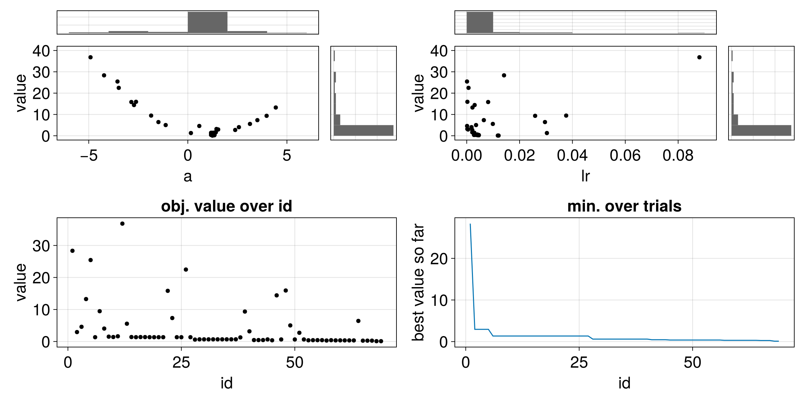

```@raw html
---
layout: home

hero:
  name: "BigHOPs.jl"
  text: "Hyperparameter optimization framework geared towards cluster computing"
  actions:
    - theme: brand
      text: Get started
      link: /introduction
    - theme: alt
      text: Samplers
      link: /samplers
    - theme: alt
      text: Benchmarks
      link: /benchmarks
    - theme: alt
      text: View on GitHub
      link: https://github.com/dom-linkevicius/BigHOPs.jl

features:
  - title: Modularity
    details: Any sampler runs with any executor. Pick random, quasi-random, Gaussian-process or successive-halving samplers, and run them serially, on threads or on a cluster.
    link: /introduction
  - title: Benchmarked samplers
    details: The samplers are benchmarked and, where possible, compared with the literature to check that their performance matches, with practical recommendations on which to pick.
    link: /benchmarks
  - title: Convenience
    details: Checkpointing, clean stopping, time limits, failure tracking, stateful objectives and summary plots.
    link: /general_functionalities
---
```

```@raw html
<style>
.VPHero .heading .name.clip {
  background: none;
  -webkit-text-fill-color: var(--vp-c-text-1);
  color: var(--vp-c-text-1);
  margin-bottom: 0.4em;
}
</style>
```

## Quick example

```julia
using BigHOPs, CairoMakie, AlgebraOfGraphics

f(x; pre_artefact=nothing) = ((x.a - 1)^2 + (log10(x.lr) + 2)^2 + 1 / x.r, nothing)
domains = (a=Continuous(-5, 5), lr=Continuous(-4, -1; transform=exp10))
ho = Hyperoptimizer(Stateful(f), domains, BOHB(R=27))
run!(ho; executor=Threaded())
printmin(ho)
fig = summaryplot(ho; figure=(; size=(1200, 600), fontsize=24),
                  axis=(; xticklabelsize=24, yticklabelsize=24))
```


