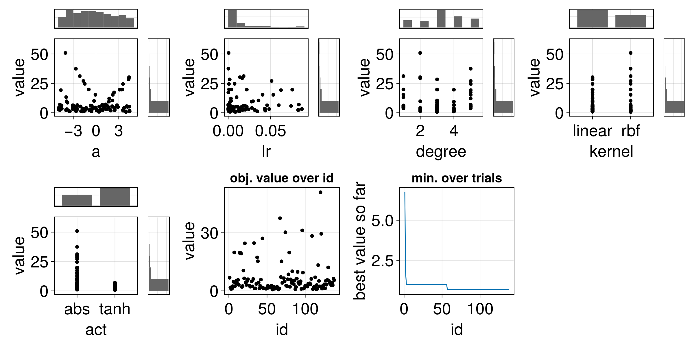

# Introduction

`BigHOPs.jl` is a hyperparameter optimization library meant to be used in situations where individual function evaluations are costly. It is geared to be modular, extensible, to play well with compute clusters, taking care of common functionality and use cases to make hyperparameter optimization as straightforward as possible.

!!! warning
    The package is still under development and some of the features or implementations may change.

Briefly, the samplers and executors are decoupled, the sampler is the only object dictating how to sample the candidates and the executor is the only object dictating how objective evaluations should be done. This allows for different composition of executors and samplers, depending on the optimization problem and available resources. Having first defined a `Hyperoptimizer` with a sampler in it, call it `ho`, we then specify the executor at runtime, when calling `run!`.

```@docs; canonical=false
run!
```

Internally, `run!` alternates between drawing candidates from the sampler and handing them to the executor, running the following procedure:

```text
start the executor
repeat
    while the target is not reached, the sampler has a candidate ready and the executor has capacity
        x = the sampler's next candidate
        the executor starts evaluating f(x)
    wait until the executor has finished at least one evaluation
    for each finished evaluation
        record its result in ho and pass it on to the sampler
    save a checkpoint, if one is due
until no more candidates will be drawn and no evaluation is running
shut the executor down
```

Note that a sampler can have no candidate ready while it waits on results.

If you want to contribute to `BigHOPs.jl` or request a sampler, executor or other functionality see [Contributing](@ref). We next present a runnable sample code snippet, which you can use to get started, with each object and function explained in the [Manual](domains.md).


## Sample code

```julia
using BigHOPs
using DataFrames: DataFrame
using Random

# The objective receives all hyperparameters as one NamedTuple `x` -- the sampler's
# resource level is `x.r`. Bigger `x.r` means more noisy samples averaged together, so the
# estimate sharpens as more resource is spent. Wrapped in `Stateful`, so a trial promoted to
# a higher `x.r` only pays for the *extra* samples, continuing from `pre_artefact` instead of
# restarting from scratch.
function noisy_bowl(x; pre_artefact=nothing)
    x.a > 4.5 && error("simulated failure for a > 4.5 -- BigHOPs marks this a Failed trial and keeps going")
    n_done, total = pre_artefact === nothing ? (0, 0.0) : pre_artefact
    centre = x.kernel == "rbf" ? 3.0 : -1.0
    loss = x.act(x.a - centre)^2 + (log10(x.lr) + 2.5)^2 + (x.degree - 3)^2
    n_new = x.r - n_done
    total += sum(loss + 0.5randn() for _ in 1:n_new)
    n_done += n_new
    return total / n_done, (n_done, total)
end

# `transform` must be a named function: checkpoints store functions by name, so an anonymous
# `u -> 10.0^u` would not survive a reload.
domains = (
    a=Continuous(-5.0, 5.0),                  # uniform over [-5, 5]
    lr=Continuous(-4, -1; transform=exp10),   # log-uniform over [1e-4, 1e-1]
    degree=Ordinal([1, 2, 3, 4, 5]),          # ordered, so 2 lies between 1 and 3
    kernel=Nominal(["rbf", "linear"]),        # unordered, no level is "between" any other
    act=Nominal(Function[tanh, abs]),         # values can be functions; plots label them by name
)

# iterations=2 replays the whole bracket schedule twice: 4 brackets, 138 trials in total.
ho = Hyperoptimizer(Stateful(noisy_bowl), domains, Hyperband(R=27, iterations=2))

# save_path/save_every checkpoint the run every 10 trials told -- after a crash, resume with
# `ho = load_hyperoptimizer(Stateful(noisy_bowl), "ho_checkpoint.jld2")`, then `run!` again.
run!(ho; executor=Threaded(), save_every=10, save_path="ho_checkpoint.jld2")

printmin(ho)     # best trial found so far
DataFrame(ho)    # every trial (including any Failed ones), with its parameters and value

using CairoMakie, AlgebraOfGraphics  # summaryplot needs both loaded to activate the extension
# figure/axis/scatter/histogram/line all pass through
fig = summaryplot(ho; figure=(; size=(1200, 600), fontsize=28),
                  axis=(; xticklabelsize=28, yticklabelsize=28, titlesize=22))
for ax in fig.content  # thin out the ticks, leaving the categorical panels' labels alone
    ax isa Axis || continue
    ax.yticks = WilkinsonTicks(3)
    if !(ax.xticks[] isa Tuple)
        ax.xticks = WilkinsonTicks(3)
    end
end
```


