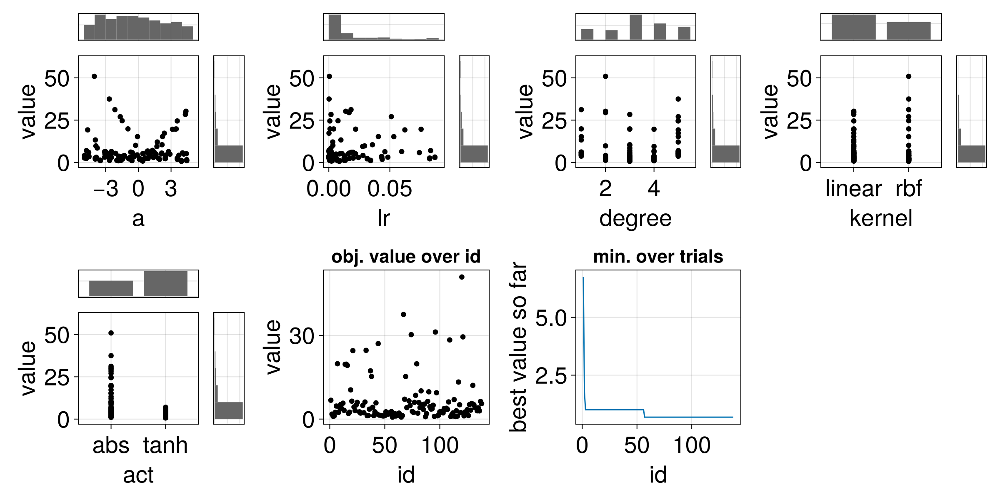

# Plotting

Diagnosing a hyperparameter optimization during or after it finishes can be a complex task. To make things easier `BigHOPs.jl` provides some convenient plotting functionality. Namely, `summaryplot` gives an overview of a hyperparameter optimization run from its completed trials. It works on a finished run as well as on one that was stopped or is loaded from a checkpoint (counting only `Completed` trials). Since the used plotting libraries can be heavy, `BigHOPs.jl` does not directly depend on them. `summaryplot` becomes available once `CairoMakie` and `AlgebraOfGraphics` are loaded.

```julia
using BigHOPs
using CairoMakie, AlgebraOfGraphics

ho = Hyperoptimizer(f, domains; sampler=SobolSampler(), n=100)
run!(ho)

fig = summaryplot(ho)
save("summary.png", fig)
```

```@docs; canonical=false
summaryplot
```

An example, from a `Hyperband` search over five hyperparameters is given below:



The figure is a grid of panels, as close to square as possible:

- **One panel per hyperparameter:** the objective value of each completed trial against that hyperparameter, with a histogram of the hyperparameter's values above it and a histogram of the objective values to its right. Non-numeric values, such as the functions of a `Nominal` domain, are shown by name, with one bar per value.
- **Obj. value over id:** each completed trial's value against its trial id, in the order the trials were started.
- **Min. over trials:** the best value among the completed trials up to each id.

With a successive-halving sampler, trials at every resource level are plotted together, so the low-resource trials add noisier values to every panel.

The keyword arguments are passed on to the Makie calls: `figure_kwargs` to `Figure`, `axis_kwargs` to every `Axis`, `scatter_kwargs` to the scatter plots, `histogram_kwargs` to the histograms and `line_kwargs` to the running minimum. They take precedence over the defaults, e.g. for a larger figure with smaller markers:

```julia
summaryplot(ho; figure_kwargs=(; size=(1600, 1200)), scatter_kwargs=(; markersize=5))
```